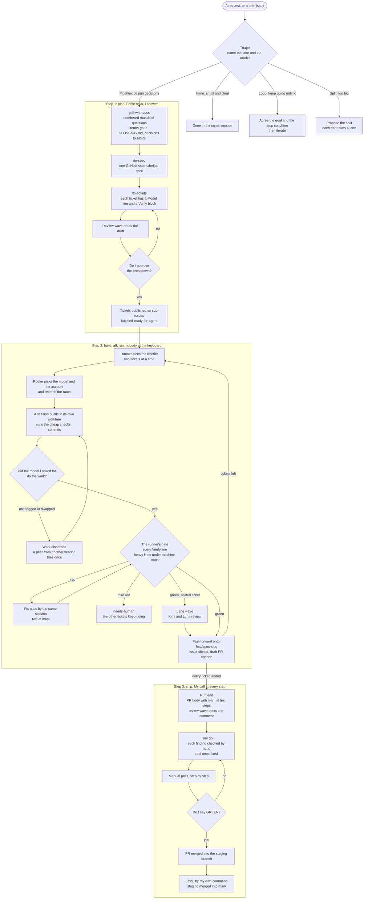

# claude-harness, a case study

claude-harness is the configuration folder behind my Claude Code sessions. It holds the rules every session loads, a runner that builds tickets while I am away, a router that picks the model for each job, and hooks that block what must never happen.

Status: in daily use, private, still changing. The figures below are the ones recorded in the repo's own docs and run records as of 2026-11-12.

This repository holds no code. It describes how the harness is put together and why, with the numbers that forced each choice and the places where it is still weak.

## The problem

I work alone and run coding agents all day, on several projects at once. Before the harness, the same failures kept coming back.

- I got what I asked for, which was not what I wanted. Nobody knows exactly what they want until someone asks the awkward question, and a model that starts coding at once never asks it.
- Sessions were dead by mid-afternoon. A session that reads every log and every test run into its own context has no room left for the work.
- "Should pass" was reported as done. A model will say a change works without having run anything.
- Work stopped when I walked away. A plan executed in one long session waited on me, and a session that died mid-plan left its state in a half-ticked file.
- The wrong model did the job. The most capable model on a rename wastes money. A cheap model on API design wastes the afternoon.
- Everything came out looking the same. Left alone, a model reaches for the same gradient in the hero and the same "Certainly!" opener in the prose.
- A merge into `main` depended on the model remembering an instruction.

Each rule in the harness exists because one of these kept happening. The mechanism beside each rule is what stopped it.

The short picture is a small software shop that lives in a folder.

- **A planner** (Fable) interviews me before anything gets built, one round of questions at a time, and writes the answers down as a spec and a set of tickets.
- **Builders** (Opus, mostly) each take one ticket to their own desk, a git worktree, so nobody steps on anybody else.
- **Inspectors** (review legs from Claude, GPT and Kimi) read finished work and report problems. They never fix anything.
- **A foreman** (the runner) hands out tickets and checks every piece itself before it goes on the shared shelf.
- **A dispatcher** (the router) decides who gets each job.
- **Locks on the doors** (hooks) block what must never happen, whatever a model remembers or forgets.
- **A librarian** (the brain) hands every session a card of what the project has decided, and answers questions with quotes from its docs.

Nothing reaches `main` without me.

## How work flows



Diamonds are decisions. Three of them are mine alone: the breakdown, GREEN and the merge into `main`.

1. **Triage.** Every request gets one of four lanes and a named model before work starts. Inline is small and unambiguous. Pipeline has real design decisions. Loop is "keep going until X", with the goal and the stop condition agreed first. Split is too big for one session, so the session stops and proposes the split.
2. **Grill.** For pipeline work, Fable asks its questions in numbered rounds, each with the answer it would pick, and I type the real ones. I am editing answers, which is faster than writing them. New terms go into a glossary and decisions into ADRs.
3. **Spec.** The agreed design becomes one GitHub issue.
4. **Tickets.** The spec is split into tickets small enough for one fresh session. Each names its model and ends with a `Verify` block of shell commands that must all exit 0. A review wave reads the draft, and nothing is published or built until I approve the breakdown.
5. **Build.** The runner starts the tickets whose blockers are closed, two at a time, each session in its own git worktree.
6. **Gate and land.** The runner first reads the session's transcript. If a safety filter stopped the model, or another model answered in its place, the work is thrown away and a model from another vendor tries once. Then the runner runs the ticket's whole `Verify` itself. Green fast-forwards the ticket onto the spec's integration branch. Red hands the same session the failing line for a fix pass, twice at most. A third red parks the ticket for me while the rest keep building.
7. **Run end.** When every ticket has landed, the PR from the integration branch into the staging branch gets a body with manual test steps, and a review wave posts its findings as one comment. No fix pass follows on its own.
8. **My review.** When I say go, each finding is checked by hand and the ones that hold up get fixed. A final walk-through ends in my explicit GREEN, and the PR merges into the staging branch. Merging staging into `main` is a separate action that I take myself, one command at a time.

The tail of a ticket looks like the example below. The heavy lines are copied character for character from the project's gate file, and a ticket whose heavy lines differ is rejected before any session starts.

```text
**Model:** opus

## Verify
npm run typecheck
npm run lint
heavy browser ram:4 -- sh -c 'npm run build && node tools/gate.js --touched'
heavy cpu -- npm test
```

## What runs around every session

The flow above is half the harness. The other half fires on its own, in any session, in any project. Fifteen hook entries cover five events, and every one fails open, so a broken hook lets the session continue.

```mermaid
flowchart LR
  subgraph s1 ["Session starts"]
    a1["refresh pulls the harness<br/>and re-applies its mirrors"]
    a2["brain hands over the project's card"]
    a3["router records the session"]
  end
  subgraph s2 ["Each prompt"]
    b1["router adds an advisory label"]
    b2["brain adds pointers to docs"]
  end
  subgraph s3 ["Each tool call"]
    c1["Before Bash: four guards<br/>merge to main, dev server,<br/>chained branch switch, heavy lines"]
    c2["Around an Agent dispatch:<br/>router routes it, then records<br/>which model answered"]
    c3["After a write: design tells,<br/>frontmatter, brain check"]
  end
  subgraph s4 ["Session ends"]
    d1["reaper kills what the session left running"]
  end
  s1 --> s2 --> s3 --> s4
```



A mirror is a copy of the rules inside another tool. The harness keeps one in the Codex CLI, one in Kimi Code and one in T3 Code, and one script applies all of them.

## The parts

**The runner.** `afk` is one Python file on the standard library that builds a spec's tickets with nobody at the keyboard. Every decision in it is a rule over tracker state and exit codes. Sessions build and never decide. Its memory is the comments it writes on each ticket, so a stopped run resumes from the tracker at no cost. It refuses to start while the integration branch is checked out anywhere else or while its own checkout is behind. It never answers a session that asks for approval. It stops after three hours of wall clock, whatever is left.

**The gate.** The gate is the runner's own run of a ticket's `Verify` lines on the merged tree, and it is the only thing that can call a ticket green. Lines a project declares heavy, such as test suites, builds and browsers, first take machine-wide slots. The caps are two browsers, one device, one GPU, one CPU-bound job, and memory up to half the machine. A gate has 15 minutes by default. A hook refuses a ticket session its own heavy lines. The runner never re-runs a red gate to see whether it passes this time. It reads nothing from prose, so a stale gate file fails the run and never shrinks the gate.

**The router.** Every model choice passes through it, from ticket sessions to review legs, consolidations and subagent dispatches. A cheap classifier gives the task one of eight labels with a probability for each. Hard rules then run in a fixed order and can override the label, and a tracked table maps the result to models. Every route, rule hit and reroute goes into one SQLite store that can be replayed against a candidate table. Fable, gpt-6-astra and Kimi are restricted. A ticket that names one of them without a reason from that model's closed list runs on Opus. A classifier answer under 0.6 confidence routes on a default label. The router never changes the model of the conversation I am in, and its hooks fail open, so a broken router never blocks a session.

**The review wave.** A review is a set of legs started together over the same contract and the same diff. A diff of at most 500 changed lines and 10 files gets one Opus reviewer. Anything larger gets at least Opus and gpt-6.1-sol, and a diff that touches a security surface adds Kimi K3.1 Pro. When two or more legs run, Fable consolidates them once into a single list, with each finding checked against the contract and the code. Reviewers never fix anything. No leg's findings are applied while another leg is still running. Findings are evidence, not orders.

**The guardrail hooks.** These are shell scripts that run around a tool call and say no, whatever the model remembers. One blocks merges, rebases and pushes onto `main`, `master` or `staging`. One refuses a ticket session the heavy lines that belong to the gate. One blocks a bare dev server. One flags stock AI design and prose signatures after a write. They fail open when their input does not parse, so a broken hook never bricks a session. They make no claim to be a security boundary. The merge guard's own documentation says it "stops a session's mistake, not a session set on landing work".

**The brain.** A project opts in with one file. From then on its decision records, its glossary and its notes are searchable, and they stay markdown in the project's repo. A hook gives every session a card of the current decisions by title, capped near 1,500 tokens. Another adds up to three pointers when a prompt uses a word the docs define. Search is keyword fused with vectors, because a test on my own docs found 21 of 30 paraphrased questions that way against 16 for keyword alone. An answer is a quoted excerpt with its path, its date and whether it is still current.

**The sealed lane.** Security work that a Claude model would be stopped on goes to Kimi alone. Kimi builds the ticket, and a Kimi leg and a gpt-6-luna leg review it before it lands. It is built and tested and has barely been used, which is under "What it costs".

**The selftests.** Each script has a suite that runs against stubs, with no model call and no network. The runner's suite has 472 tests and is the harness's own gate, one line in its gate file. The router's suite has 188. At the last audit the merge guard's had 142, most of them generated rows of one hook payload each. The copies of the rules that the harness keeps in other vendors' CLIs prove themselves with a `--check` mode that writes nothing. The suites get audited too, and the result is under "Measured".

Models and agents map to jobs by a table in the rules file. These are defaults, and work that misses the bar on a cheaper model is redone on a better one.

| Job | Who does it |
|---|---|
| Grilling, specs, ticket sets, consolidating a review wave | Fable 5.2 |
| Every ticket by default, debugging, the Claude review leg | Opus 5.5 |
| Fact-finding in a fresh context: searches, logs, inventories | Sonnet 5.5, as the `scout` agent |
| The default cross-vendor review leg, bulk edits that need some structure | gpt-6.1-sol |
| Bulk edits where speed is the point | gpt-6-luna |
| The third review leg on a security surface | Kimi K3.1 Pro |
| Checks that drive a real browser or app, image generation | gpt-6-astra |

Four agent definitions carry those jobs inside a session. `worker` implements and returns the test output with the change. `reviewer` reads from a fresh context and never fixes. `scout` finds facts and never decides what to change. `reasoner` makes the judgement calls an Opus session hands off, and shows its reasoning.

## Skills

24 skills. A `/` before a name means only I can trigger it, by typing the command.

| group | skills | for |
|---|---|---|
| Planning | `grilling`, `grill-me`, `grill-with-docs`, `domain-modeling`, `codebase-design`, `/to-spec`, `/to-tickets` | Questioning a design, naming things, and turning the result into a spec and tickets. |
| Building | `/implement`, `tdd`, `diagnosing-bugs`, `user-journey-testing` | Building one ticket, test-first work, hard bugs, and clicking through the real app. |
| Review | `codex-review`, `/pr`, `/retro` | Running a review wave, writing the PR body, and retros that turn lessons into config changes. |
| Other vendors | `codex-implementation`, `codex-computer-use`, `codex-image` | Handing bulk edits, browser checks and images to GPT models. |
| Design | `design-from-references`, `motion-design` | Matching a reference's layout before writing code, and animation timing. |
| Writing | `writing-for-agents`, `unslop` | Writing instructions models follow, and cutting AI tells from prose. |
| Sessions | `/handoff`, `pickup` | Passing work to a fresh session. |
| Iterating | `hillclimb` | A council of models grades one artifact blind while a fresh designer revises it. |

## A month of use

These counts come from records the harness keeps about itself, read on 2026-11-12.

| What | Count | Window |
|---|---|---|
| Runner runs | 139 | since 2026-10-07 |
| Runs that ended with every ticket landed | 30 of the last 50 with a stop record | |
| Runs stopped by a usage limit | 6 of the same 50 | |
| Routing decisions stored | 2,533 | 19 days |
| Ticket sessions routed | 171, of which 166 on Opus | 19 days |
| Review waves routed | 82 | 19 days |
| Calls to the review skill | 117 | 30 days |
| Subagent dispatches | scout 448, reviewer 267, reasoner 127, worker 17 | 30 days |

The numbers also show what is not used. The rule that keeps sealed work on Kimi has fired once, on an advisory. The rule that hands flagged work to another vendor has changed one route. The retro skill ran zero times in 30 days.

## Why it is built this way

Each decision below is a record in the private repo, written when the decision was made, with the incident or the measurement behind it. The numbers are quoted as recorded.

**Tickets build in parallel, each in its own worktree, and land by fast-forward on one integration branch per spec.** The simpler shape was every ticket committing straight onto one feature branch, one session at a time. It needs no merger and cannot collide. It also caps the pipeline at one ticket at a time, which makes a dependency graph of tickets pointless. I took the parallel shape from Matt Pocock's `implement-spec`.

The cost is that two tickets touching one shared file collide at landing time, not at planning time. The ticket writer has to add a blocking edge between them, or the spec has to pin the names both will add. A landing that conflicts gets one bounded merge session and then goes to a human. And a gate that reads untracked material, such as a local database or a gitignored fixture, can pass vacuously in a worktree. Such a ticket says so and runs attended in the main checkout.

**Specs and tickets live in GitHub Issues.** Local markdown files were the simpler input for the runner, with no network, no rate limits and state that travels with the branch. I rejected them because the tracker should be the place where I already look at work, with a UI, comments and history, and not a second system that only agents read. The runner's progress is comments on the tickets, which is why a stopped run resumes for free.

It costs two things. A ticket's `Verify` lines run as code on my machine, so write access to a repo's issues is write access to the machine. And GitHub's blocked-by count drops only when a blocker closes, so the runner closes a ticket the moment its branch lands on the integration branch.

**A ticket's suite runs once, in a gate the runner owns, and never in the session.** The first contract asked each session for the full suite three times: at the end of the build, at its gate, and after merging the integration tip. The runner ran it a fourth time, and sessions added about three runs of their own. Measured over three specs of Promptfall, that came to 7.4 full runs per landed ticket, enough to overheat the machine and fail gates on false timeouts. Now a session runs typecheck, lint and the test files it changed, and a hook refuses it the suite.

What I gave up was a session that sees its own red before it reports done. The fix pass buys that back. On a red gate the runner resumes the same session with the failing line and the tail of its output, twice at most. Some costs remain. A session's "done" no longer claims the suite is green, since only the gate's comment does. Sessions stay on disk so they can be resumed. A Codex session cannot be resumed at all, so its fix pass is a fresh, narrow run given the gate's output and the diff.

**A gate runs the checks the diff selects, under machine-wide caps, and both are declared where code can check them.** One project's gate ran its whole verification matrix on every ticket: 17 configurations, 8 browsers, 1,000 page loads, 8 to 10 minutes with the Mac unusable. Under that load its own timing checks went red, and one spec spent four full gates on each of two tickets, three of them on flakes. Three things changed together. A project lists its heavy lines once in a versioned gate file, and the ticket validator rejects a ticket whose heavy lines differ from it. The project's own test runner selects modules from the diff through a coverage map in its code. And the single lock became counted caps per resource class, held across every session and every run on the machine.

I rejected having the ticket writer name each ticket's modules, because the mapping would then be one model's judgement checked by another model. I rejected a per-ticket field read by the runner, because the runner would have to know every project's flags. I rejected deriving heavy lines from a sentence in the rules file, because "prose maintained by a model goes stale with nothing to catch it".

The cost is that nothing runs the full matrix any more, at run end included. The coverage map is the new risk, so it is checked on every run. A glob that matches no file refuses the run, a changed path no module claims selects every module, and a diff that touches the map itself selects every module. The caps are cooperative. A browser opened outside them is not stopped, only reported.

**A slow gate is a note, never a failure.** Two gates grew toward or past the 900 s budget in the same fortnight, and both were cut back only after a measurement forced it: the harness's selftest from about 665 s to 79 s, and one project's site gate from 803.8 s to 64 s. Growth had only ever shown up as budget kills, and sixteen of eighteen reds on that site gate were load or the budget, not a bug. The runner already wrote every gate line's seconds into its logs. Nothing read them back. Now a green gate carries one line when a heavy line passes 1.5 times the median of its last five samples, or when the whole gate passes half its budget. The 1.5 was measured by replaying the logs. The same gate swings about 25% run to run with no code change.

I rejected a red for slowness. Sixteen of eighteen reds were already noise, and each red buys a fix pass that is a full gate. I rejected a baseline file in the repo, because a ticket could edit the baseline its own gate is judged by. I rejected a store shared across machines, because a two-core VPS and an eight-core Mac must not be compared anyway.

It costs thin history and one blind spot. On the Mac, 318 of 495 gate logs predate per-line timing and count as no samples. A gate that grows 1.4 times per step never trips the ratio, since its median moves with it. Only the absolute line, 450 s on the default budget, catches that.

**Hard rules decide a route, and a classifier only labels the work.** Every model choice used to be static. A ticket's model line, a table and a review skill with a hard-coded second leg decided who ran what before anyone had looked at the work, and every diff got the same two review legs plus a consolidation. The only measurement of that, four PRs compared by hand on 2026-10-24, showed the second leg earning its keep on large diffs and adding nothing on small ones. On barber-app PR #23, about 179 files, the second leg raised 18 findings, 10 shared with Opus and 8 its own, 7 of which were fixed. On another project's PR it raised 10 findings, 3 its own. On two small PRs it raised one finding each, both already raised by Opus. The harness also kept no record of its routing, so there was nothing to tune against.

The classifier is Jev, a structured decision model at $0.042 per million input tokens. I rejected a classifier-first design, where its label is the final word and rules apply only when it has no answer. The record's reason is that "the constraints that cost money or break a contract" would then depend on a classifier's confidence. So Jev labels, the rules bind, and both outcomes are stored so the rules can be backtested against the labels.

The cost is one more moving part in front of every dispatch, and thresholds with little behind them. The 500-line and 10-file rule rests on those four PRs. The router also cannot split a review leg that is too big for one context.

**Flagged work fails and moves to another vendor's model, and never continues on a lesser one.** Claude Code runs its models behind safety classifiers. By default a flagged request re-runs on a fallback model and the session stays there. The main conversation shows a notice. A subagent shows nothing. The harness's likeliest trigger is its own work, such as a consolidation that reads security findings from three vendors. Until this decision nothing noticed, and a run could land a diff, a review or a consolidated list of findings that Opus 4.8 wrote, under the name of the model I had asked for. Now the fallback is switched off and the runner reads every transcript for the model behind each reply. A flagged session is a failed one. A peer may take the work up, meaning another vendor's model within two points on my intelligence scale, each tried once. When I am watching, the session stops and asks me.

I rejected letting it fall back and marking the output, because the work still lands and the mark is only as good as whoever reads it. I rejected a retry on another Claude model, because Opus and Fable flag the same content. I rejected parking every flagged unit for a human, because in an unattended run one flagged review leg would stall a whole run end.

The holes are written down. The setting does not hold inside a subagent, so a hook comparing the requested model with the served one is the only thing that sees a swap there. A Codex refusal carries no machine marker and goes undetected. The shape of a flag in a transcript has never been observed, since I do not provoke one on purpose. The check did catch a real model change, in the very thread that wrote this decision record.

**Merges into `main` are blocked by a hook, whatever the prompt says.** Branches and PRs into the staging branch need no permission. Anything landing on `main`, `master` or `staging` is denied by a hook that parses the command before it runs. One authorised action is unlocked by prefixing that single command with `ALLOW_MAIN_MERGE=1`. The alternative was the instruction alone, which means trusting the model to remember it on every command of every session.

The hook is a text matcher, and its documentation lists what gets past it: a variable holding `git`, an `eval`, a push destination set in config. The override is text on the command, so a session can write it itself. The guard catches mistakes. The gate and my review of the PR are what catch the rest.

**Each machine refreshes its copy of the harness on a push and at session start, never on a timer.** The harness runs on two machines, a Mac and a VPS, each with its own checkout. Nothing moved a checkout when `main` moved, and nothing re-applied a machine's copies of the rules in other tools afterwards, so the two drifted until someone remembered. T3 Code, the app I run sessions through, has an auto-pull setting that looked like the answer. Read in its source at v0.1.6, it was not. It pulls once at server start, then every 30 seconds only while a client is active on that machine, which on a headless VPS is never the hours the runner works. It refuses on any untracked file. It re-applies nothing. It would swap the runner's code under a running run. So `refresh` is the harness's own job. A GitHub workflow starts it on the VPS on every push to `main`, and a session-start hook runs it on both machines.

I rejected a timer on each machine, since I want the checkout moved by the event and not by polling. I rejected a hook on `git push`, which misses every merge done on GitHub. I rejected letting a refresh stash local changes. A refresh never commits and never writes to origin, so a modified tracked file stops it and gets reported.

It costs some waiting and some manual work. A refresh is deferred while a run is active, so a run never executes two versions of the harness, and the runner refuses to start on a checkout that is behind. A failed push trigger shows up as a red workflow run on GitHub and nowhere else. Logins stay by hand, once per machine.

## Measured

Two measurements changed the harness. Both are small, and the limits are stated next to the results.

### Which model reviews beside Opus

The question was which model the routing table names as the default second review leg. The test bed was barber-app PR #23, 179 files and 16,294 insertions, whose consolidated review holds 22 hand-verified findings: 1 blocker, 5 major and 16 minor. Each candidate got the earlier review's prompt, changed only where it names the tree and the diff range, on a detached worktree at the PR's head, and the two GPT candidates ran at the same time. A finding counted as raised when it matched by file and issue, whatever the wording.

| | gpt-6-sol at `max` | gpt-6.1-sol at `xhigh` | Kimi K3.1 Pro at `high` |
|---|---|---|---|
| Raised, of the 22 | 8 (36%) | 10 (45%) | 7 (32%) |
| Findings reported | 11 | 10 | 8 |
| Extras judged real and new | 1 | 0 | 0 |
| Duration | 364 s | 475 s | 577 s |
| Cost at list API rates | $0.80 | $0.69 | not priced |

The rule was that higher recall wins, and that within two findings the cheaper run wins. Both readings pick gpt-6.1-sol at `xhigh`, and the routing table now names it. Kimi's run was the first Kimi review the harness scored, so it set no route.

The limits matter here. It is one PR and one run per model. The 22 findings came from an Opus leg and a gpt-6-astra leg, so the ground truth is what those two models saw. The two Sol runs had a read-only sandbox and could not run the test suites, while the astra and Kimi runs could, so the Sol numbers compare fairly only with each other. And none of the three candidates raised any of the five findings that only Opus had raised. That last result is the argument for running more than one leg on a large diff.

### What made the selftest slow

The harness's own gate is its selftest, and it had reached 665 s. The measurement ran the full suite at one commit on both machines, with the clock taken inside the resource slot so that queueing did not count.

| Run on the Mac, 8 cores | Wall clock | Per test |
|---|---|---|
| Serial, git through Xcode's launcher shim | 654.9 s | 1.71 s |
| Serial, git resolved to the real binary | 467.2 s | 1.22 s |
| Parallel, 8 workers | 78.9 s | 0.21 s |

| Machine | Baseline, 366 tests, serial | After, 384 tests, parallel | Change |
|---|---|---|---|
| Mac, 8 cores | 665 s | 78.9 s | 8.4 times faster |
| VPS, 2 cores | 268 s | 158 s | 1.7 times faster |

The tests were not the problem. The git shim alone cost 188 s of a serial run, 29%. Eight workers gave 5.9 times the serial speed, not 8, because each test slows down when eight run at once. Pruning 22 tests saved no wall time, since a parallel run is bound from below by its slowest test, 11.8 s here.

What changed is the cost of every change to the harness. Its gate had taken 1,017 to 1,278 s on an earlier spec. On the three tickets built once the suite ran in parallel it took 88 s, 83 s and 80 s. The measurement also killed an idea. A template repo per test case was not built, because per-case setup is at most 13.8% of a parallel run, under the one-fifth threshold set for it. And it found a defect. On the two-core machine, four full parallel runs all failed, and the cause was five tests racing the runner the same way. Each stub now waits until the runner has recorded what the stub depends on.

An earlier audit had read every test in seven suites against the current code and traced each one's history. It found 29 stale tests and 23 weak ones. Most of the stale ones were duplicates that a later commit had made redundant. One test ran a token-column case and never checked the columns. Another had been racy from its first commit.

## What it costs and where it is weak

- I am the bottleneck by design. A spec that builds while I sleep still waits for my review, my manual pass and my GREEN before it reaches the staging branch, and for a second action from me before it reaches `main`.
- The runner's loop stops while a gate runs, so a free build slot waits out every gate. This is an open issue.
- The guard hooks are text matchers. A variable, an `eval` or a config setting gets past the merge guard, and its override is a string a session could type.
- The resource caps are cooperative. A browser opened outside them is reported, not stopped.
- Write access to a repo's issues is write access to my machine, because a ticket's `Verify` lines run as code.
- Flag detection has holes. A subagent's swap is seen only by a hook after the fact, a Codex refusal is not detected at all, and the transcript marker the runner keys on has never been seen in a real flagged session.
- The routing thresholds rest on four PRs, and the choice of review model rests on one PR with one run per model.
- The model scores are partly my opinion. Intelligence and speed come from Artificial Analysis. Taste is my own judgement, and for several models it is provisional. I hold Fable at 10 for intelligence against an index score of 51, three under Opus, on the strength of plans I judged myself. Those scores were taken for Fable 5.1 and now sit on 5.2, which has not been scored.
- Timing history is per machine and starts thin, and slow creep under the ratio is caught only at half the budget.
- A gate in a worktree can pass vacuously when it reads untracked files.
- The suites rot. The audit above found 52 stale or weak tests across seven suites.
- Setup is manual where it touches credentials. Every login is made by hand on each machine, and nothing automates one.
- Parts of it are built and barely used. The sealed lane has an ADR, its own review wave and runner code, and no sealed ticket has been routed yet. A run that finishes itself was built in seven tickets and never merged. Every session still pays to read the rules for both.
- The router is blind where it matters most to me. Half of the one-line advisories on a prompt come back with no label, and most session records carry no model, so it often cannot say whether a session is on the right one.
- One Kimi review leg in five fails, hits a limit or times out, and nothing reads Kimi's usage window ahead of a run.
- The loop that should turn mistakes into rule changes is not running. Zero retros in the last 30 days.
- It fits one person. Anyone else would have to rewrite the model table, the routing table and most of the rules.

## Credits

- The engineering skills are forked from [mattpocock/skills](https://github.com/mattpocock/skills) and edited for this workflow: `grilling`, `tdd`, `diagnosing-bugs`, `domain-modeling`, `codebase-design`, `writing-for-agents`, `to-spec`, `to-tickets`, `implement`, `pr` and `handoff`. The parallel build shape is Pocock's `implement-spec`.
- `motion-design` is [LottieFiles](https://lottiefiles.com)' skill, MIT.
- Everything else is mine, and keeps changing through retros.

The harness itself is private. It is my working configuration, tied to my machines and my projects, and it is not packaged for anyone else to run. This case study is the public record of how it works and why.

Kevin Shibuya, [kevinshibuya.com](https://kevinshibuya.com), hello@kevinshibuya.com. The text is licensed under [CC BY 4.0](LICENSE).
